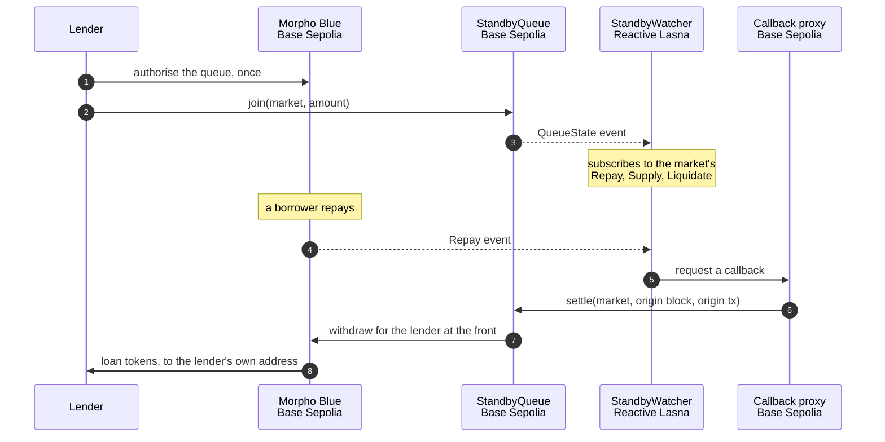

# Standby

**An exit queue for lending markets that have run dry, settled by the Reactive Network.**

When a Morpho Blue market is fully borrowed, lenders cannot withdraw. Standby lets a lender queue once and be
paid the moment liquidity returns, in order of arrival, with no keeper, no bot and nothing of their own running.
A reactive contract on the Reactive Network watches the market and triggers every payout.

**[Live page](https://standbyhq.vercel.app)** · **[Demo video, 2:55](https://youtu.be/kmcIP80Cjw0)** ·
**[One full loop on-chain](#one-loop)** · **[Check it yourself](#check-it-yourself)**

Built for the Reactive Omni Buildathon, track *Every Second Counts*.

| | |
|---|---|
| **What it is** | A first-in, first-out exit queue for a Morpho Blue market at 100% utilisation |
| **Chains** | Reactive Lasna (the reactive contract) and Base Sepolia (the queue and Morpho Blue) |
| **Full-loop latency** | Median **1.4 s**, 90th percentile 1.8 s, 99th percentile 2.0 s, over 220 measured loops |
| **Against a rival** | The queue paid first in 41 of 41 races when the rival was 2 s or more behind, and in 0 of 36 when the rival was within 0.8 s |
| **Tests** | 42 Foundry tests against Morpho Blue's deployed bytecode. No keys, no RPC |
| **Source** | All three contracts verified on Sourcify, exact match |
| **Status** | Testnet. Not audited. [Limits](#limits) are listed in full |

The run shown in the demo video:
[the repayment](https://sepolia.basescan.org/tx/0xcdfaf5643ee74ce00c3e58cbc0c644c63d277816bab29e077d24e1ee8e0e758a)
in Base Sepolia block 62,183,942,
[the watcher's reaction](https://lasna.reactscan.net/tx/0xefedfabf02599a4aa51b1bc61f6954013c23852f04f72d65c211512e645c6565)
in Lasna block 8,981,757, and
[the lender paid](https://sepolia.basescan.org/tx/0x630d39d3950cd3f8fecd2d7997313cd0041235839c8f1b8b9b65073ace1ff5ba)
in Base Sepolia block 62,183,949. Seven blocks, 1.4 seconds.

## Contents

- [The problem](#the-problem)
- [How it works](#how-it-works)
- [What the Reactive Network does here](#what-the-reactive-network-does-here)
- [Deployed (testnet)](#deployed-testnet): addresses, [try it](#try-it), [check it yourself](#check-it-yourself), [one loop](#one-loop)
- [Latency, measured](#latency-measured)
- [What history says about freed liquidity](#what-history-says-about-freed-liquidity)
- [The race: what a second buys](#the-race-what-a-second-buys)
- [Refusals, on-chain](#refusals-on-chain)
- [Design and safety](#design-and-safety)
- [Limits](#limits)
- [Layout](#layout), [build and test](#build-and-test), [the page](#the-page)

## The problem

A Morpho Blue market lends out what its lenders supply. When borrowers have taken all of it, `withdraw` reverts
for every lender: the market has nothing left to pay them with. Liquidity comes back only when a borrower
repays, someone supplies, or a position is liquidated. It then goes to the first transaction that asks for it,
which may be another lender's withdrawal or a new loan. A lender who wants out has to watch the market and be
first, every time, for as long as the market stays full.

This is not hypothetical. The USR / USDC market on Base has been full since March 2026 with 1.23M USDC of
lender deposits in it. Seven repayments or liquidations have arrived since then. Five of the seven were first
drawn on by a new borrower, not by a lender ([the study is below](#what-history-says-about-freed-liquidity)).

Standby replaces "whoever is watching" with "whoever has waited longest".

## How it works

1. **Join.** A lender authorises `StandbyQueue` on Morpho once and joins with an amount. The position stays in
   Morpho and keeps earning; the queue never holds lender funds.
2. **Watch.** `StandbyWatcher`, a reactive contract on Reactive Lasna, follows the queue's own state. While a
   market has lenders waiting it subscribes to that market's `Repay`, `Supply` and `Liquidate` events on Morpho,
   and unsubscribes when the queue empties.
3. **Settle.** When liquidity returns, the watcher requests a callback. `StandbyQueue.settle` accepts it only
   from the chain's callback proxy carrying the watcher's address, re-reads the market's real liquidity, and
   withdraws for the lenders at the front, straight to their own addresses. If the liquidity is already gone
   it pays nothing and changes nothing.



Each callback carries the block and the transaction hash of the event that caused it. The queue subtracts that
block from its own and records the full-loop latency of every settlement on-chain (`lagHistogram()`), and its
`Loop` event names the origin transaction, so any payout can be traced back to the event that freed the money.

## What the Reactive Network does here

The reactive contract is not an add-on. It is the only thing that settles the queue when liquidity returns:
`settle` cannot be called by a keeper, a bot, or the lenders themselves, only by the callback proxy on behalf of
the one watcher fixed at deployment. `StandbyWatcher` does four jobs:

- **It follows the queue, not a fixed list of markets.** It subscribes to the queue's `QueueState` event. When a
  market's first lender joins it opens three Morpho subscriptions for that market, and it closes them when the
  queue empties. A market nobody is waiting on costs nothing.
- **It reacts to the three events that put liquidity back**: `Repay`, `Supply` and `Liquidate`, filtered by
  market id.
- **It carries the origin through the loop.** The origin block and transaction hash travel inside the callback,
  which is what lets the queue measure every loop on-chain instead of trusting a script.
- **It asks again when one callback is not enough.** A callback serves at most six tickets. If more are due and
  liquidity is left, the queue says so and the watcher requests another callback.

Why the speed of Reactive Omni matters: Omni reads origin-chain logs from the latest block as soon as it
appears, and that is what puts the payout a median of seven Base Sepolia blocks behind the repayment. The
[race](#the-race-what-a-second-buys) measures what that buys. The queue is first against any rival slower than
its own loop, so every second taken off the loop shuts more rivals out.

## Deployed (testnet)

| Contract | Chain | Address |
|---|---|---|
| `StandbyWatcher` | Reactive Lasna (5318007) | [`0x9FA9c9876325Fd30f5e62D97DbC5A543dAc24414`](https://lasna.reactscan.net/address/0x9FA9c9876325Fd30f5e62D97DbC5A543dAc24414) |
| `StandbyQueue` | Base Sepolia (84532) | [`0x757CD246b40A7D58c178ABb7CCEDa5Fb60BFf926`](https://sepolia.basescan.org/address/0x757CD246b40A7D58c178ABb7CCEDa5Fb60BFf926) |
| `TryIt` | Base Sepolia (84532) | [`0x7Bb5EC188C91e91feC5d430944d551Ce8C6b8ffE`](https://sepolia.basescan.org/address/0x7Bb5EC188C91e91feC5d430944d551Ce8C6b8ffE) |
| Morpho Blue (not ours) | Base Sepolia | `0xBBBBBbbBBb9cC5e90e3b3Af64bdAF62C37EEFFCb` |
| Reactive callback proxy (not ours) | Base Sepolia | `0x476F44b11F5C942c58f4c8E3d0300E5710743585` |

All three are source-verified on Sourcify (exact match):
[watcher](https://repo.sourcify.dev/5318007/0x9FA9c9876325Fd30f5e62D97DbC5A543dAc24414),
[queue](https://repo.sourcify.dev/84532/0x757CD246b40A7D58c178ABb7CCEDa5Fb60BFf926),
[TryIt](https://repo.sourcify.dev/84532/0x7Bb5EC188C91e91feC5d430944d551Ce8C6b8ffE).

The demo market is our own market on the real Morpho Blue: test tokens sbUSD
(`0xa600E633cDbBe3003D6626e1b37dB0dbE0AaaF49`) and sbETH (`0x039217f10c00642A52144eB4a8dd24972e246F72`), an oracle
we set (`0xFb6931BD12e428191b193211002D190C49470e5f`), Morpho's AdaptiveCurveIrm and an 86% LLTV. Market id
`0x321754d492bcd755a8b2be25eb2662875a132880158d8975b21e823853bd237a`.

### Try it

Anyone can run a loop. Call `tryIt()` on the `TryIt` contract with any Base Sepolia account. It mints 100 test
dollars and repays that much of the demo borrower's debt, and does nothing else. A second or two later the
queue pays the lender at the front, in a transaction you did not send. `outcome(n)` on the same contract then
shows one callback delivered and 100 paid since your call, and the queue's `Loop` event carries your
transaction's hash.

```bash
cast send 0x7Bb5EC188C91e91feC5d430944d551Ce8C6b8ffE "tryIt()" --rpc-url https://sepolia.base.org --private-key $KEY
cast call 0x7Bb5EC188C91e91feC5d430944d551Ce8C6b8ffE "outcome(uint256)(uint256,uint256,uint256)" 0 --rpc-url https://sepolia.base.org
```

The first call was made by an account that is neither the lender nor the borrower:
[`0xc9ae43de…f08d3a`](https://sepolia.basescan.org/tx/0xc9ae43de8538416b903ab21352d10ec3a6556a04aef6afd9117618d9a9f08d3a).
It works while the demo lender still has a ticket open and the queue has callback budget left.

The [live page](https://standbyhq.vercel.app) has a button that sends the same call from a browser wallet and
then shows the queue's payment arriving. Some wallets warn about newly registered sites; the `cast` command
above does the same thing without one.

### Check it yourself

Read-only calls against the live queue. None of them needs a key.

```bash
Q=0x757CD246b40A7D58c178ABb7CCEDa5Fb60BFf926
M=0x321754d492bcd755a8b2be25eb2662875a132880158d8975b21e823853bd237a
RPC=https://sepolia.base.org

cast call $Q "loops()(uint64)" --rpc-url $RPC                     # callbacks received so far
cast call $Q "loopsThatPaid()(uint64)" --rpc-url $RPC             # of those, the ones that paid a lender
cast call $Q "openTickets(bytes32)(uint256)" $M --rpc-url $RPC    # lenders waiting in the demo market
cast call $Q "pendingAssets(bytes32)(uint256)" $M --rpc-url $RPC  # what they are owed, 18 decimals
cast call $Q "liquidity(bytes32)(uint256)" $M --rpc-url $RPC      # what the market can pay now: 0 while it is full
cast call $Q "lagHistogram()(uint32[64])" --rpc-url $RPC          # settlements by blocks after the origin event
```

Position `n` of `lagHistogram()` is the number of settlements that landed `n` Base Sepolia blocks after the
event that caused them. Multiply by 0.2 for seconds.

### One loop

The market was fully borrowed and one lender was queued for 200,000 sbUSD. A borrower repaid 261.

| Step | Chain | Block | Transaction |
|---|---|---|---|
| Repayment (the origin event) | Base Sepolia | 61,375,955 | [`0xb97a2a4d…6ec98c`](https://sepolia.basescan.org/tx/0xb97a2a4d0ee7efcf9366406311b1598405c8b3c41a5d6eb8904643fd4b6ec98c) |
| Watcher reacts, requests the callback | Reactive Lasna | 8,829,400 | [`0xfd290c83…0944b0`](https://lasna.reactscan.net/tx/0xfd290c83c73f5ce241ad70eecc9b4f0349a9a662f9db2f62730b40f06f0944b0) |
| Queue settles, pays the lender 261 | Base Sepolia | 61,375,960 | [`0xc90c4cec…fadfb3`](https://sepolia.basescan.org/tx/0xc90c4cec8898a4030793f266f3f709040294a21c454c231f4108a6e8c9fadfb3) |

Five Base Sepolia blocks from repayment to payout. At 0.2 s a block that is 1.0 s. Latency is counted in Base
Sepolia blocks, because the origin event and the payout are on the same chain and its blocks are 0.2 s apart.
The queue records it itself: the `Loop` event of the settlement carries the origin block and the origin
transaction hash.

An earlier deployment (queue `0xC0BAA9aFe6C810b584D52e6b1EE5a849CA538642`, watcher
`0x9F0c2ca01276d9d7AA064b876bcf2b0b9880E9bc`) ran the very first loop in nine blocks. It was replaced after
testnet use showed that a wallet's gas estimate for `join` skipped the on-the-spot payment; `join` now reverts
when it is sent too little gas to pay.

## Latency, measured

220 loops on the deployment above, each one a real transaction on Base Sepolia that put liquidity back into the
fully borrowed market: 200 repayments by the borrower and 20 supplies by a third account, of 50 to 500 sbUSD,
sent 0.3 to 3 seconds apart. Lender, borrower and supplier are three separate accounts. Every loop settled and
every one paid the lender the full amount that came back.

| Full loop: origin event to lender paid | Base Sepolia blocks | Seconds |
|---|---|---|
| Fastest | 4 | 0.8 |
| Median | 7 | 1.4 |
| 90th percentile | 9 | 1.8 |
| 99th percentile | 10 | 2.0 |
| Slowest | 17 | 3.4 |

| Blocks | 4 | 5 | 6 | 7 | 8 | 9 | 10 | 17 |
|---|---|---|---|---|---|---|---|---|
| Loops | 1 | 48 | 33 | 40 | 37 | 48 | 12 | 1 |

Repayments alone: median 7 blocks. Third-party supplies alone: median 8 blocks. A settlement that pays one
lender uses about 194,000 gas.

How this was measured, and how to check it:

- `measure/run.py` sends the origin transaction and records three hashes per loop: the origin transaction, the
  watcher's transaction on Reactive Lasna, and the settlement. All 220 are in [`data/loops.jsonl`](data/loops.jsonl).
- `measure/verify.py` then fetches every receipt from both chains and checks that the Lasna transaction and the
  settlement both name that origin transaction, and that the blocks match. Only loops that pass are counted.
  All 220 passed. The result is [`data/summary.json`](data/summary.json).
- Nothing is timed with a local clock. Latency is the settlement's block minus the origin's block.
- The queue keeps the same record on-chain. At the end of the run (Base Sepolia block 61,386,945)
  `lagHistogram()` on the queue returned the distribution above, count for count. It keeps counting: the
  callbacks of the race below and of anything since are in it too.

One thing could not be measured. The loop has two legs, Base Sepolia to Lasna and Lasna back to Base Sepolia,
and splitting the 1.4 s between them needs the two chains' clocks to agree. Lasna stamps its blocks in whole
seconds, and its stamps read about two seconds behind Base Sepolia's: in most loops the Lasna transaction is
stamped *earlier* than the event it reacted to. So only the end-to-end figure is given. The Lasna transaction
of every loop is in the data for anyone who wants to look.

## What history says about freed liquidity

Does speed matter here? To find out, the full history of five Morpho Blue markets that are fully borrowed
today was downloaded from Morpho's API (69,603 supply, withdraw, borrow, repay and liquidation events) and
each market's liquidity rebuilt event by event. Then every moment was found where a market was full and an
event put at least 100 USDC back, and how long it took before anyone took liquidity out again.

| Market | Chain | Events | Inflows into a full market | Gone in the same transaction | Taken in the next block | 2 to 5 blocks | 6 to 30 blocks | Later |
|---|---|---|---|---|---|---|---|---|
| USR / USDC | Ethereum | 28,342 | 452 | 15 | 6 | 16 | 62 | 353 |
| wstUSR / USDC | Ethereum | 14,809 | 243 | 56 | 1 | 3 | 22 | 161 |
| sdeUSD / USDC | Ethereum | 17,954 | 249 | 7 | 0 | 7 | 32 | 203 |
| deUSD / USDC | Ethereum | 1,019 | 22 | 0 | 0 | 0 | 2 | 20 |
| USR / USDC | Base | 7,479 | 313 | 98 | 0 | 0 | 3 | 212 |
| **All five** | | **69,603** | **1,279** | **176** | **7** | **26** | **121** | **949** |

Of the 1,103 inflows that outlived their own transaction:

| First taken out again | Inflows | Share |
|---|---|---|
| within 12 s | 7 | 0.6% |
| 12 s to 60 s | 29 | 2.6% |
| 1 to 10 minutes | 223 | 20.2% |
| later than 10 minutes | 844 | 76.5% |

What this shows, and what it does not:

- **It does not show a race measured in seconds.** In these five markets freed liquidity was taken within one
  Ethereum block seven times in 1,103. A loop of 1.4 seconds and a loop of 9 seconds would have reached the
  same liquidity. This project does not claim that bots empty these markets in seconds; the data says they
  did not.
- **It shows that whoever was watching got paid, and that most lenders were not watching.** Three quarters of
  the time the money sat for more than ten minutes, and then went to whoever came first, not to whoever had
  waited longest. A queue that reacts in the next second or two is first every time, for every lender in it,
  in arrival order, with nobody watching anything.
- **It shows freed liquidity being lent out again instead of reaching lenders.** In 110 of the 1,103 cases the
  first taker was a new loan, not a withdrawal. In the Base USR / USDC market, stuck since March 2026 with
  1.23M USDC of lender deposits in it (supplies minus withdrawals; Morpho's own page shows about 100M, because
  unpaid interest keeps accruing), seven repayments or liquidations of 13 to 2,220 USDC arrived while it was
  full (counting from 10 USDC up); five of the seven were first drawn on by a new borrower, two by a
  withdrawing lender. The quickest of the seven was touched 92 seconds later.
- 176 inflows were taken out again inside the transaction that brought them (a supply and a withdrawal or
  loan in one call). Nothing outside that transaction could have reached them, this queue included.

The seconds matter for a different reason, which the next section measures: against a rival who *is* watching,
the queue wins only if its loop is shorter than the rival's.

To reproduce: `python3 history/fetch.py <chain id> <market id>` downloads a market (the five used are listed in
`history/markets.json`, their data is in `history/data/`), `cd history && python3 report.py` prints the tables.
The seven Base cases are listed by
`python3 history/analyse.py history/data/8453-0xff0f2bd5.jsonl.gz --block-time 2 --since 1774137600 --min-inflow 10 --list`.
A market's rebuilt liquidity never goes below zero in any of the five and ends at zero, as it must for a
market that is full today.

## The race: what a second buys

History has no rival fast enough to test the queue, so one was built. A second lender in the same market, not
in the queue, withdraws by hand: in each trial the borrower repays 100 sbUSD and, a chosen time later, the
rival sends `withdraw(100)` straight to Morpho. Only one of them can have the 100. Both transactions are
signed beforehand and pay the same fee. The result is binned by where the rival's transaction actually landed.

120 trials. In 6 the rival landed before the repayment and no race took place. The other 114:

| Rival's withdrawal landed | Races | Queue paid its lender first | Rival took it |
|---|---|---|---|
| in the same block, or up to 4 blocks later (up to 0.8 s) | 36 | 0 | 36 |
| 5 to 9 blocks later (1.0 to 1.8 s) | 37 | 19 | 18 |
| 10 or more blocks later (2.0 s and beyond, up to 9 s) | 41 | 41 | 0 |

Block by block through the contested range:

| Blocks after the repayment | 4 | 5 | 6 | 7 | 8 | 9 | 10 |
|---|---|---|---|---|---|---|---|
| Queue first / races | 0 / 7 | 2 / 9 | 3 / 7 | 2 / 6 | 4 / 6 | 8 / 9 | 12 / 12 |

This is the latency distribution seen from the other side. A rival who gets a withdrawal in within 0.8 seconds
of the repayment beats the queue every time, a rival who needs 2 seconds or more loses every time, and in
between it is decided by which transaction lands first. When the queue lost, its callback still arrived, found
no liquidity, paid nothing and changed nothing: those 54 settlements are on-chain and each cost the queue only
gas. Every trial is in [`data/race.jsonl`](data/race.jsonl) with the four transaction hashes (repayment, Lasna
reaction, settlement, rival), all read back from the chains; `python3 measure/race_stats.py data/race.jsonl`
prints the full table.

Set against the history above: of 1,103 real inflows, 7 were touched within 12 seconds. A loop of 1.4 seconds
would have been first for all the others.

## Refusals, on-chain

| Case | What happened | Transaction |
|---|---|---|
| `settle` called directly by an ordinary account | Reverted: only the callback proxy may call it | [`0x4ef1141a…57b9da`](https://sepolia.basescan.org/tx/0x4ef1141ab73c2c1ac382b36fb45a1139435ac2848d09213fbc4753fffd57b9da) |
| A callback asked for by another reactive contract ([`Impostor`](src/demo/Impostor.sol), [its request on Lasna](https://lasna.reactscan.net/tx/0x1f83eae43f7824c4f13659b59014789916ae1a1467902e23cb30fd5ef5c8007f)) | The proxy delivered it stamped with the impostor's address; the queue refused it and nothing changed | [`0x3cda0e42…7bafa6`](https://sepolia.basescan.org/tx/0x3cda0e42c1b364399c40a6d328ab815843e23ba62ef41f088542116e007bafa6) |
| A lender joins, then revokes the queue's authorisation on Morpho; a repayment follows | Their ticket was voided, their position was not touched, and the lender behind them was paid in the same settlement | [`0x06c0de82…c219cb`](https://sepolia.basescan.org/tx/0x06c0de8203d717b9904eee6fad6886d3ace24e9b5ebfd07045bdaa2717c219cb) |
| A callback that arrives after the liquidity is gone | Paid nothing, changed nothing (54 times in the race) | [`data/race.jsonl`](data/race.jsonl), winner `rival` |

## Design and safety

- **The queue never holds lender funds.** A position stays in Morpho, in the lender's name, earning interest
  until it is paid out. A payout is a Morpho `withdraw` on the lender's behalf with the lender as receiver, so
  the tokens go from Morpho to the lender's own address and never pass through the queue.
- **One permission, revocable.** The only thing a lender grants is Morpho's `setAuthorization` for the queue.
  Revoking it voids the ticket at the next settlement and touches nothing else. `cancel` leaves the line at any
  time, and anything already paid stays paid.
- **Callbacks are authenticated twice.** `settle` requires the caller to be the chain's callback proxy and the
  request to come from the one watcher address fixed in the constructor. Both refusals are
  [on-chain](#refusals-on-chain).
- **Every settlement re-reads the market.** The queue accrues interest and reads Morpho's real liquidity before
  paying, so a late, repeated or unwanted callback pays nothing and changes nothing.
- **Strict first-in, first-out, with partial fills.** The front ticket is paid as far as the liquidity goes and
  keeps its place for the rest. A ticket is capped at the lender's position, and a lender holds one ticket per
  market.
- **Bounded work per callback.** At most six tickets are served per call, and the loop stops early when less
  than 250,000 gas is left for a ticket, so a callback that runs short of gas never voids a ticket by accident.
- **No owner and no settable parameter on the queue.** The watcher has an owner who can bind the queue once and
  take back the watcher's own REACT; that owner has no power over the queue or over any lender.
- **Who pays.** A join costs a fixed fee of 0.000001 ETH, which funds the callbacks; on the Reactive Network the
  contract that receives a callback pays for it. The watcher pays for its reactions in REACT.

## Limits

- **A withdrawal within about a second of the repayment beats the queue**, and one in the same block always
  will. The race above shows where the line is. The queue is first against anyone slower than its own loop.
- **A stranger can spend the queue's callback budget.** The refused callback in the table above still cost the
  queue 5.8e-7 ETH: on the Reactive Network the contract that receives a callback pays for it, wanted or not.
  The stranger pays for each request on Reactive. The budget is the join fees and whatever anyone sends the
  queue; lender funds are never in the queue and cannot be reached this way.
- **Supplying and withdrawing in one transaction** also makes the queue pay for a callback that finds nothing.
- **A short gap when a queue forms.** The watcher subscribes to a market's Morpho events when its first lender
  joins. Liquidity that returns before those subscriptions are live is picked up at the next event, not that one.
- **The two legs of the loop are not timed separately** (see above).
- **Testnet.** The market is our own, on the real Morpho Blue, with test tokens and an oracle we set. The
  contracts have not been audited.

## Layout

| Path | What |
|---|---|
| `src/StandbyQueue.sol` | The queue and callback contract, on the market's chain |
| `src/StandbyWatcher.sol` | The reactive contract, on Reactive Lasna |
| `src/demo/` | A mintable token and a settable oracle for the testnet demo market, and `TryIt`, one public call that runs a loop |
| `script/Deploy.s.sol` | Deployment, in the order the two contracts need |
| `measure/` | The harness that runs loops on testnet, the verifier that reads them back from both chains, the race |
| `data/` | Every measured loop, with its three transaction hashes, and the statistics |
| `history/` | The study of five real Morpho markets: download, analysis, data |
| `test/` | 42 Foundry tests, run against the Morpho Blue bytecode deployed on Base Sepolia |
| `web/` | The project page. It draws its figures from `data/` and reads the queue live from Base Sepolia |

## Build and test

```bash
git clone --recurse-submodules https://github.com/big14way/standby && cd standby
forge test
```

No keys and no RPC endpoint are needed. The tests place the exact bytecode of Morpho Blue and of its
AdaptiveCurveIrm, as deployed on Base Sepolia, at the addresses they have there (`test/fixtures/`), and play
the Reactive Network with a relay that hands the watcher only the logs it is subscribed to and delivers the
callbacks it asks for. They cover:

- who may join, and that a ticket is capped at the lender's position;
- strict first-in, first-out payment, partial fills, and the queue's totals, including a fuzz test;
- repayments, third-party supply and liquidations all triggering a settlement;
- a callback that arrives after the liquidity is gone: it pays nothing and changes nothing;
- a lender who revoked the authorisation or already left Morpho: their ticket is voided, the next is paid;
- a queue longer than one callback serves: the watcher is told more is due and asks again;
- the refusals: `settle` called directly, or through the proxy by another reactive contract;
- the watcher's subscriptions opening when a queue forms and closing when it empties;
- a callback short of gas never voiding a ticket, and a full callback fitting its gas limit;
- the on-chain latency record.

## The page

```bash
cd web && npm install && npm run dev
```

`npm run data` rebuilds `web/src/data.json` from `data/loops.jsonl`, `data/summary.json` and
`data/race-summary.json`, so every figure on the page is one of the measured ones. The "Run it with a wallet"
button sends `tryIt()` from the visitor's own wallet and then waits for the queue's `Loop` event that names
that transaction.

## Credits

- [Morpho Blue](https://github.com/morpho-org/morpho-blue) (interfaces, share maths, and the protocol itself in tests)
- [reactive-lib-omni](https://github.com/Reactive-Network/reactive-lib-omni) (base contracts for reactive and callback contracts)
- [forge-std](https://github.com/foundry-rs/forge-std)
- Page: [viem](https://viem.sh), [Motion](https://motion.dev), and the typefaces Manrope, Geist and Geist Mono (SIL Open Font License)

## License

MIT. See [LICENSE](LICENSE).
